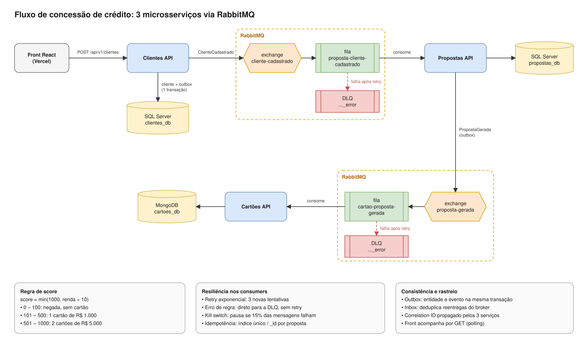

# Fluxo de Crédito: front

Interface para **cadastrar clientes e acompanhar em tempo real** o fluxo de concessão de crédito: cadastro → proposta → emissão de cartões, processados por três microsserviços que se comunicam via RabbitMQ. Uma área de moderação, protegida por login, lista os clientes já cadastrados.

| | |
|---|---|
| **Produção** | https://parana-credito-web.vercel.app |
| **Stack** | React 19 · TypeScript · Vite, sem bibliotecas de UI |

## Sumário

- [A solução completa](#a-solução-completa)
- [O que a tela faz](#o-que-a-tela-faz)
- [Clientes cadastrados](#clientes-cadastrados)
- [Como executar localmente](#como-executar-localmente)
  - [Variáveis de ambiente](#variáveis-de-ambiente)
- [Estrutura](#estrutura)
- [Build e deploy](#build-e-deploy)

## A solução completa

| Serviço | Responsabilidade | Repositório |
|---|---|---|
| **Clientes** | Cadastra o cliente e publica `ClienteCadastrado` | [parana-clientes-api](https://github.com/gustavobordig/parana-clientes-api) |
| **Propostas** | Calcula o score, decide o crédito e publica `PropostaGerada` | [parana-propostas-api](https://github.com/gustavobordig/parana-propostas-api) |
| **Cartões** | Emite os cartões da proposta aprovada | [parana-cartoes-api](https://github.com/gustavobordig/parana-cartoes-api) |
| Front | Cadastro, acompanhamento do fluxo e listagem de clientes | este |



Versão editável: [`docs/fluxograma.drawio`](docs/fluxograma.drawio), que abre no [draw.io](https://app.diagrams.net).

## O que a tela faz

- **Cadastro** com máscara de CPF e prévia do score conforme a renda digitada.
- **Preencher exemplo:** gera um cliente diferente a cada clique: nome, e-mail, CPF válido, idade entre 18 e 70 anos e uma renda sorteada para cair em cada um dos três resultados (negado, 1 cartão ou 2 cartões).
- **Linha do tempo** das três etapas. Proposta e cartões são gerados por eventos, de forma assíncrona; a tela consulta as APIs a cada segundo até cada etapa ficar pronta.
- **Cartões emitidos** desenhados com número mascarado e limite.
- **Consulta** de um cliente existente pelo id.
- **Erros de validação** da API listados na tela, todos de uma vez.
- **Correlation ID:** cada fluxo gera um id enviado no header `X-Correlation-Id` e mostrado na tela; com ele, a mesma operação é encontrada nos logs dos três serviços.
- Identidade visual do Paraná Banco (azul da marca, Montserrat) e layout adaptado a tablet e celular.

## Clientes cadastrados

A aba **Clientes cadastrados** é a área do moderador e **exige login de moderador**. As credenciais não ficam no repositório: são enviadas aos examinadores à parte.

- **Login** em `POST /api/v1/auth/login` da Clientes API, que devolve um token JWT com data de expiração.
- **Listagem paginada** em `GET /api/v1/clientes`, com o token no header `Authorization: Bearer`. Mostra nome, CPF (já mascarado pela API), e-mail, renda e data do cadastro, do mais recente para o mais antigo, com anterior/próxima, a página atual e o total de clientes.
- **Acompanhar:** cada linha abre o fluxo daquele cliente na aba principal, com a linha do tempo de proposta e cartões.
- **Sessão:** o token fica só no `sessionStorage` (some ao fechar a aba), nunca no `localStorage` nem na URL. Antes de cada listagem, a tela compara a expiração com a hora atual; se o token expirou ou a API responde 401, a sessão é apagada e o login volta com o aviso "Sessão expirada". O botão **Sair** apaga o token.
- **Limite de tentativas:** a API aceita 5 logins por minuto por IP; acima disso a tela mostra "Muitas tentativas. Aguarde 1 minuto.".
- Usuário e senha não são guardados, e o campo de senha é limpo a cada tentativa.
- Todas as chamadas continuam enviando o `X-Correlation-Id`.

## Como executar localmente

**Pré-requisito:** Node.js 20.19 ou mais recente, com as três APIs rodando (veja o README de cada uma).

```bash
npm install
```

```bash
npm run dev
```

Abra http://localhost:5174. Sem arquivo `.env`, as URLs apontam para as APIs locais (portas 5101, 5102 e 5103).

### Variáveis de ambiente

Copie `.env.example` para `.env` para apontar para outras APIs. O Vite embute os valores no **build**: ao alterá-los, gere o build de novo.

| Variável | Padrão |
|---|---|
| `VITE_CLIENTES_API_URL` | `http://localhost:5101` |
| `VITE_PROPOSTAS_API_URL` | `http://localhost:5102` |
| `VITE_CARTOES_API_URL` | `http://localhost:5103` |

As APIs só aceitam chamadas das origens configuradas no CORS delas (`Cors__Origens__0`).

## Estrutura

```
src/
├── api.ts          Cliente HTTP das três APIs, login, ProblemDetails e polling
├── types.ts        Contratos das respostas
├── sessao.ts       Token do moderador no sessionStorage e checagem de expiração
├── faixas.ts       Faixas de score e regras de crédito
├── formatos.ts     Máscara de CPF, moeda, datas e prévia do score
├── App.tsx         Abas e orquestração do fluxo cadastro → proposta → cartões
├── styles.css      Identidade visual e layout responsivo
└── components/
    ├── CadastroForm.tsx
    ├── ConsultaCliente.tsx
    ├── ClientesCadastrados.tsx   Login do moderador e listagem paginada
    ├── LinhaDoTempo.tsx
    ├── CartaoVisual.tsx
    ├── FaixasScore.tsx
    └── Icones.tsx
```

## Build e deploy

```bash
npm run build
```

Publicado na **Vercel**, com as três URLs das APIs configuradas como variáveis de ambiente do projeto. O repositório também tem um `Dockerfile` com nginx, que lê a porta de `PORT`, para publicar em qualquer plataforma de containers.
